# Godot Engine — Mariner fork

A fork of [Godot Engine](https://github.com/godotengine/godot) for *Mariner Simulator* and our future projects.
It is based on **Godot 4.7.2-stable** and adds rendering and `RenderingDevice` extensions:
- upscaling and frame generation: DLSS, DLSS-G and Reflex, AMD FSR 3.1 and FSR 3 frame generation, dynamic resolution;
- ray tracing on Vulkan and D3D12 (DXR 1.1): a path tracer, DDGI probes with screen probes and traced reflections,
  ReSTIR for many lights, ray-traced sun shadows;
- virtual geometry: cluster LOD (a cluster DAG selected on the GPU, in the view and in every shadow pass, streamed
  in pages), a compute software rasterizer for tiny instances (stones) with a visibility buffer, also in shadows;
- shadows: a scrolling shadow cache, a per-object shadow map, contact shadows, colored translucent shadows;
- GPU-driven static geometry: culling, occlusion and LOD on the GPU;
- the world's weather in materials: an overhead map with sky occlusion and cover, wetness, a water film, snow;
- detail without geometry: fake interiors behind windows, box and octahedral impostors, tessellation with true
  displacement, planar reflections, surface decals over a thin G-buffer;
- anti-aliasing of alpha cutouts (analytic fringe, distance-field masks) and of sub-pixel wires;
- post-processing: GTAO, motion blur, lens flare, gathered depth of field, histogram auto exposure, color grading;
- materials: multiple-scattering diffuse, micro-shadowing, sheen, thin-film iridescence, physical refraction, metal F0 presets;
- `RenderingDevice`: async compute, mesh shaders (Vulkan and D3D12), compute on a second GPU;
- texture mip streaming;
- fixes to stock bugs.

The original Godot README is in [`README.godot.md`](README.godot.md). The license is the same, MIT
([`LICENSE.txt`](LICENSE.txt)). Third-party SDKs keep their own licenses (see "Third-party code").

**Compatibility.** A project written for stock Godot 4.7 opens and runs in this fork unchanged. New features only
apply where they are enabled: shader render modes, project settings, node, viewport and environment properties, new
methods. New enum values are appended at the end. Most features are Forward+ only; Mobile and Compatibility keep
their stock behaviour, except for the items listed below.

Exceptions, where a stock project looks or behaves differently:
- **M1–M3 are on by default** (`rendering/shading/overrides/multiscatter_diffuse`, `micro_shadowing`,
  `multi_bounce_ao`): materials with the default Burley diffuse and materials with an AO map are lit a little
  differently, in Forward+ and Mobile. Turn the three settings off for stock shading.
- **Fixes of stock bugs** (E9, E14a, E16, E25c, `0040`, `0050`, `0053`, `0099`) change behaviour where stock Godot was wrong: leaks, reads
  past the end of buffers, lost uniform sets, missing depth passes.

### Detecting the fork

Every build of this fork carries the extensions, so it can be recognized without any special build flags:

* the feature tag **`mariner`** is always present: in the editor, in export templates, and with any `BUILD_NAME`;
* the default build name is `mariner` (`Engine.get_version_info().build`). Setting `BUILD_NAME` overrides it, so
  don't rely on the build name alone.

```gdscript
var mariner := OS.has_feature("mariner")
# For a specific capability, check the API directly. Stock Godot doesn't have the method:
var has_mesh := ClassDB.class_has_method("RenderingDevice", "draw_list_draw_mesh_tasks")
```

The feature tag also works in project setting overrides, e.g. `rendering/foo.mariner = true`.

Check new methods with `ClassDB` / `Engine.has_singleton` and call them through `call()`. Then the same game code also
runs on stock Godot.

---

## What differs from vanilla 4.7.2

| # | what | main API | drivers |
|---|---|---|---|
| **E1** | `PREVIOUS_FRAME` vertex built-in and `render_mode motion_vectors_transparent`: correct motion vectors for vertex-animated and transparent surfaces. With them, TAA, FSR2 and DLSS don't smear water and foam | shading language | Forward+ (on Mobile/Compatibility `PREVIOUS_FRAME` is always `false`) |
| **E2** | **NVIDIA DLSS Super Resolution / DLAA** via NVIDIA Streamline 2.10.0. Ported from [NVIDIA-RTX/godot](https://github.com/NVIDIA-RTX/godot) (branch `nvidia-pt-dlss`) | `Viewport.SCALING_3D_MODE_DLSS` (= 6), `Streamline` singleton, `rendering/streamline/*` | Forward+, D3D12 and Vulkan, Windows |
| **E2b** | **NVIDIA Nsight Aftermath** (GPU crash dumps) and pass markers for PIX / Nsight / RenderDoc | command line `--debug-shaders`, `--gpu-markers`; SCons `use_aftermath` | D3D12, Vulkan |
| **E3** | **DLSS Frame Generation** (including Multi Frame Generation 3x/4x), **Reflex**, **PCL**. Our addition: HUD-less color, so the UI is not interpolated | `Viewport.frame_generation`, `RenderingServer.viewport_set_frame_generation`, `rendering/streamline/reflex_mode`, `reflex_frame_limit_us`, `frame_generation_frames` | game only (not the editor), D3D12 and Vulkan, Windows |
| **E4** | **Late opaque pass**, `render_mode opaque_late`. A material reads the screen and depth and still stays opaque: it writes depth, normals and motion vectors. Needed for water with a visible volume | shading language; `RenderSceneBuffersRD.get_opaque_late_color/depth` | Forward+ |
| **E5a** | **Ray tracing scene**: ray query and descriptor indexing enabled on Vulkan, BLAS refit, variable-length texture arrays (bindless). A per-viewport TLAS is built from meshes, MultiMesh and skinned meshes, with geometry and material data, for custom `CompositorEffect`s | `rendering/raytracing/scene_acceleration_structures`, `Viewport.raytracing_scene_*`, `RenderSceneBuffersRD.get_raytracing_*`, `RD.blas_update` | Vulkan; D3D12 (E5d) |
| **E5c** | **Path tracer** (photo mode). NVIDIA's path tracer logic (BRDF, NEE, fog) moved into one compute shader with inline ray query over the E5a TLAS. Our additions: accumulation across frames, sample limit, firefly clamp, raster sky, water as a dielectric (`rt_ior`, slope maps `rt_wave_*`, foam `rt_foam_*`), raster volumetric fog<br>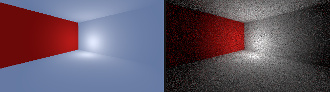 | `Environment.pathtracing_*`, `RenderingServer.environment_set_pathtracing[_accumulation]`, `Viewport.get_pathtracing_sample_count()`, `reset_pathtracing()` | Vulkan, D3D12 (E5d) |
| **E6** | **Async compute**: a second, compute-only GPU queue. Synchronized with timeline semaphores (Vulkan 1.2) or fences (D3D12). Work that can't safely go to the second queue runs on the main queue automatically | `RD.async_compute_begin/end`, `async_compute_is_supported/is_active/set_enabled/get_info`, `TEXTURE_USAGE_ASYNC_COMPUTE_BIT`, `BUFFER_CREATION_ASYNC_COMPUTE_BIT`, `rendering/rendering_device/async_compute` | D3D12, Vulkan |
| **E7** | **Mesh and task shaders** in `RenderingDevice` (`VK_EXT_mesh_shader`): `#[task]` / `#[mesh]` sections, pipelines without vertex input | `SHADER_STAGE_TASK/MESH`, `RDShaderSource.source_task/source_mesh`, `draw_list_draw_mesh_tasks[_indirect[_count]]`, `SUPPORTS_MESH_SHADER[_INDIRECT_COUNT]`, `LIMIT_MAX_MESH_*` | Vulkan; D3D12 (E7b); Metal: stubs |
| **E8** | **Compute on a second GPU** (usually an integrated GPU next to the discrete one): list of physical devices and a local `RenderingDevice` on any of them. Local devices bypass Streamline, Aftermath and XR | `RenderingServer.get_physical_devices()`, `RenderingServer.create_local_rendering_device_on(index)` | Vulkan, D3D12 |
| **E9** | Fixes: indirect MultiMesh command buffer leak (and its loss on reallocation); crash at exit when an async RD readback callback is a GDScript lambda | `RenderingDevice::buffer_is_valid()` (C++) | all |
| **E10** | **Directional shadow cache**: static geometry of each cascade is rendered once and reused, dynamic objects are drawn on top every frame<br>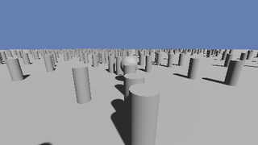 | `GeometryInstance3D.shadow_cache_mode`, `rendering/lights_and_shadows/directional_shadow/cache*` | Forward+ |
| **E10b** | **Per-object shadow map** along the sun, fitted to the object every frame (a ship)<br>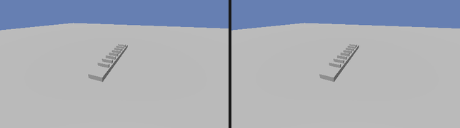 | `DirectionalLight3D.object_shadow_layers/_size/_from_cascade` | Forward+ |
| **E11** | **Screen-space contact shadows** of the sun<br>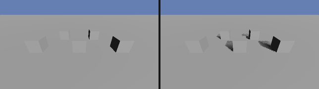 | `DirectionalLight3D.contact_shadow_length`, `rendering/lights_and_shadows/contact_shadows/*` | Forward+ |
| **E12** | **DDGI**: ray-traced irradiance probes. A world grid scrolls with the camera, plus a grid in the frame of a ship. Probes relocate out of walls. Sky and lights are kept in separate channels with live multipliers. An endless sea plane is hit by probe rays. Ray-tracing-only stand-ins<br>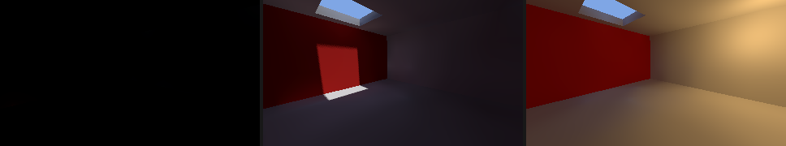 | `Environment.ddgi_*`, `DDGIVolume3D`, `GeometryInstance3D.raytracing_mode/raytracing_opacity`, `RS.environment_set_ddgi_sea` | Vulkan, D3D12 + ray query |
| **E13** | **Occlusion culling of all instances** by the depth of past frames (no occluders needed), reprojected on the CPU<br>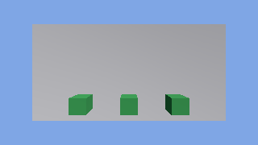 | `Viewport.use_hiz_occlusion_culling`, `hiz_occlusion_reference`, `hiz_occlusion_reference_radius`, `rendering/occlusion_culling/use_hiz_occlusion_culling` | Forward+ |
| **E14** | Instance uniforms take only the slots they use (stock: 16 per instance, ≤ 4096 instances). Indirect MultiMesh instances are culled per shadow pass on the GPU<br>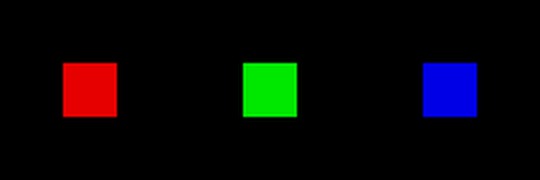 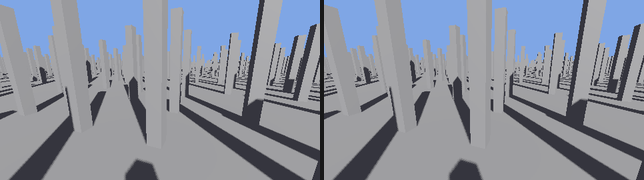 | `RS.multimesh_set_indirect_shadow_culling` | RD renderers / Forward+ |
| **E15** | **Motion blur** by the motion vectors; **lens flare** (ghosts, halo, sun starburst) and **lens dirt**<br> 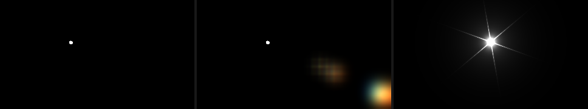 | `CameraAttributes.motion_blur_*`, `lens_flare_*`, `lens_dirt_*` | Forward+ |
| **E16** | **Parallax occlusion self-shadowing** and depth offset in BaseMaterial3D, the main light in `fragment()`. Stock fix: a shader writing `DEPTH` gets its own depth pass<br>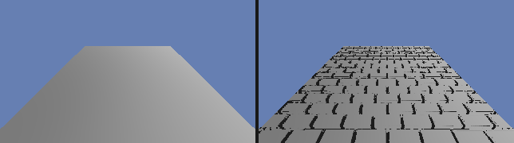 | `BaseMaterial3D.heightmap_self_shadow/_strength`, `heightmap_depth_offset`; `MAIN_LIGHT_DIRECTION`, `MAIN_LIGHT_SHADOW` | Forward+, Mobile |
| **E17** | **Texture mip streaming**: large textures load the mips the screen needs, within a VRAM budget<br>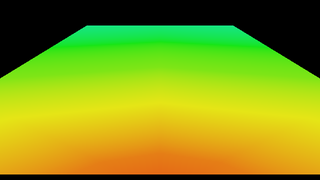 | `rendering/textures/streaming/*`, `CompressedTexture2D.get_streaming_mip()` | RD renderers |
| **E18** | **GTAO with bent normals** (ported from Spartan Engine, MIT): sky and probes sampled along the bent normal, cone-based specular occlusion, multi-bounce<br>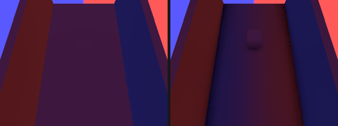 | `Environment.ssao_gtao`, `ssao_bent_normals`, `RS.environment_set_ssao_gtao` | Forward+ |
| **E19** | **Dynamic resolution**: holds a GPU frame time by changing the 3D scale<br>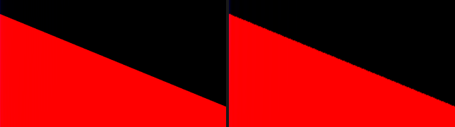 | `Viewport.dynamic_resolution_*`, `rendering/scaling_3d/dynamic_resolution/*` | all |
| **E20** | **ReSTIR DI**: many lights with ray-traced shadows and a denoiser. **E20b–d**: ray-traced shadows of the sun and the moon, including the water of E4, optionally only beyond the shadow maps. **E20e**: shadow rays run the alpha test (leaf cards, nets) and let `raytracing_opacity` through<br>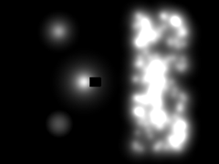 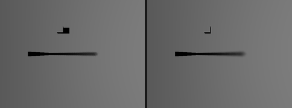 | `Light3D.light_restir`, `Environment.restir_*`, `DirectionalLight3D.restir_shadow_mode` | Vulkan, D3D12 + ray query |
| **E21** | **Colored translucent shadows** of the sun (glass, sails)<br>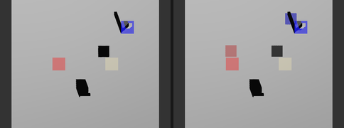 | `GeometryInstance3D.shadow_translucent`, `rendering/lights_and_shadows/directional_shadow/translucent_shadow_size` | Forward+ |
| **E22** | **Screen-space collision of GPU particles**<br>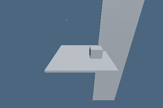 | `GPUParticles3D.collision_screen_space` | Forward+ |
| **E23** | **Gran Turismo 7 tone mapper** (from Spartan Engine, MIT), film grain, chromatic aberration, lens distortion, AMD CAS sharpening<br> | `Environment.TONE_MAPPER_GT7`, `CameraAttributes.image_*` | GT7: all three renderers; the rest: Forward+ |
| **E24** | **AMD FSR 3.1** upscaler and **FSR 3 frame generation** (FidelityFX SDK 1.1.4, MIT)<br>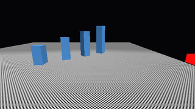 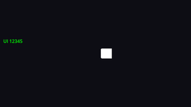 | `Viewport.SCALING_3D_MODE_FSR3` (= 7), `Viewport.frame_generation` | upscaler: Forward+; frame generation: Vulkan, D3D12 (E24c), with V-Sync |
| **E25** | **GPU-driven static geometry**: eligible meshes are grouped into batches. Per instance, on the GPU: frustum culling, occlusion against the Hi-Z of E13 or occluders, mesh LOD, visibility range. Stock fix: an indirect MultiMesh with LOD read past the LOD index buffer<br>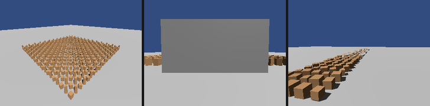 | `GeometryInstance3D.gpu_static`, `RS.scenario_get_gpu_static_info()`, `RS.multimesh_set_indirect_view_culling` | Forward+ |
| **F1** | **GTAO with a visibility bitmask** (Therrien et al. 2023): an assumed thickness of what is on screen, so thin objects don't cast dark halos<br>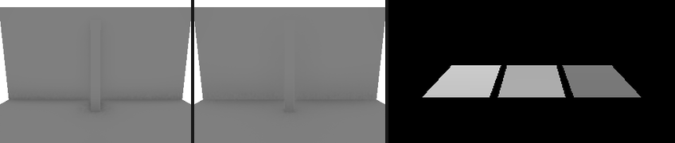 | `Environment.ssao_gtao_thickness` | Forward+ |
| **F2** | **Gathered depth of field**: half resolution, CoC tiles with near dilation, rings in the aperture shape, background layer without bleeding over sharper nearer things (no halos), foreground layer blurring over what is behind it, bokeh discs from highlights<br>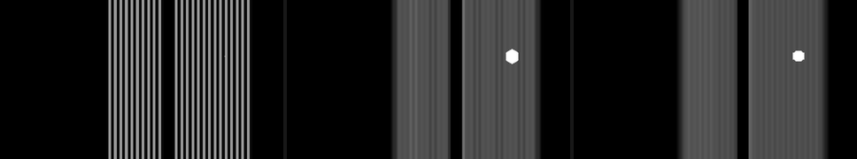 | `rendering/camera/depth_of_field/depth_of_field_mode` (Gather by default) | Forward+, one view |
| **F3** | **Color grading** in linear light: white balance (Kelvin, tint), shadows / midtones / highlights, ASC CDL in ACEScct, saturation; hue-preserving gamut mapping after the tone mapper | `Environment.color_grading_*`, `RS.environment_set_color_grading` | Forward+ |
| **F3b** | **Night vision** (Purkinje shift) in the color grading: below a scene luminance colors fade toward a tinted scotopic luminance<br>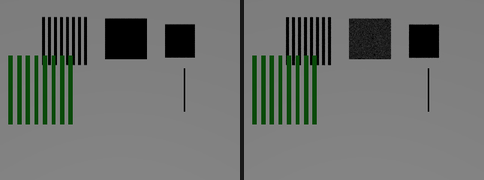 | `Environment.color_grading_night_vision*`, `RS.environment_set_color_grading_night_vision` | Forward+ |
| **F3c** | **Color grading tools**: channel mixer, contrast around the middle grey (ACEScct), vibrance, per channel curves (shadow gamma, mid point, highlight scale)<br> | `Environment.color_grading_mixer_*`, `_contrast`, `_vibrance`, `_curves_*`; `RS.environment_set_color_grading_channel_mixer` / `_curves` | Forward+ |
| **G1a** | **Overhead map and sky occlusion**: the depth of the scene from above around each camera (whole-texel steps), and the sky / color ambient light and sky reflection darkened from it under roofs, decks and bridges, between walls, in streets and valleys (as CryEngine's height map AO). Overhangs and walls told apart; not where SDFGI, VoxelGI, lightmaps or DDGI apply<br>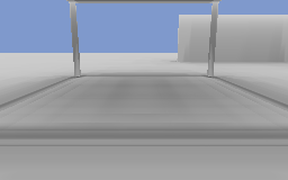 | `Environment.overhead_map_*`, `RS.environment_set_overhead_map` | Forward+ |
| **G1b** | **Sky occlusion and cover in shaders**: fragment built-ins `SKY_OCCLUSION` (the sky visibility from the overhead map) and `OVERHEAD_COVER` (1 under a roof, a deck or a bridge: no rain, no snow), VisualShader inputs; 1 / 0 without a map<br>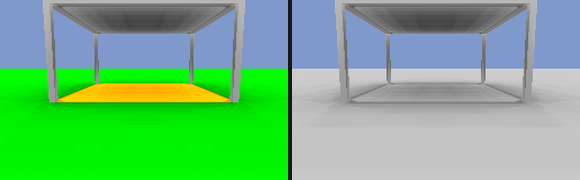 | shading language, VisualShader | Forward+ (Mobile, Compatibility: defaults) |
| **G1c** | **Particles collide with the overhead map** outside the view: rain and snow land on roofs, decks and the ground without collision nodes; particles under a cover are not moved onto it | `GPUParticles3D.collision_overhead_map`, `RS.particles_set_overhead_map_collision` | Forward+ |
| **G2** | **Histogram auto exposure**: the log luminance in 64 bins, the mean between two percentiles (the darker half and the brightest 2 % - sun, lamps, windows - left out by default), center weighted, separate adaptation speed toward darker scenes; the same 1x1 luminance the tone mapper reads<br>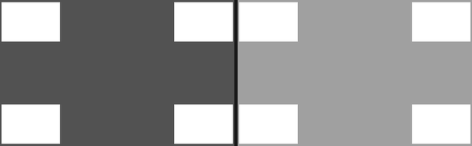 | `CameraAttributes.auto_exposure_mode`, `_low_percentile`, `_high_percentile`, `_center_weight`, `_speed_dark`; `RS.camera_attributes_set_auto_exposure_histogram` | Forward+ (Mobile: average) |
| **G3** | **Light clip volumes**: a box in the light's space outside which an omni, spot or area light does not shine (a cabin lamp does not light the deck through the hull); surface lighting and volumetric fog; editor box; clipped lights stay rasterized<br>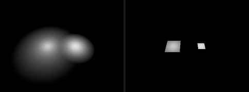 | `Light3D.clip_volume_enabled`, `_offset`, `_size`; `RS.light_set_clip_volume` | Forward+, Mobile |
| **G4** | **Wet materials**: the world's wetness (`WETNESS` in shaders) set by the game's weather; porous surfaces darken, a water film smooths them (less on steep faces), puddles on flat ground below a level of the height map; dry under cover (`OVERHEAD_COVER`)<br>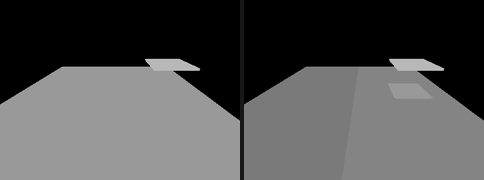 | `Environment.wetness`, `BaseMaterial3D.wetness_*`, `RS.environment_set_wetness` | Forward+, Mobile (no cover) |
| **G5a** | **Fake interiors behind windows** (interior mapping): a box room behind every window of a UV grid seen with the right perspective, from an atlas of room images (random room per window and per instance), glass on top, lit windows at night<br>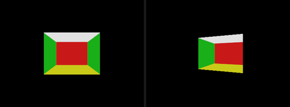 | `BaseMaterial3D.interior_*` | all |
| **G5b** | **Box impostors**: a model far away drawn as its bounding box - color, normals and relief per face in a square atlas, the deep parallax tracing the view ray into it (true ray, binary search, silhouette from the relief, depth for intersections and shadow maps); a baker and an editor tool<br>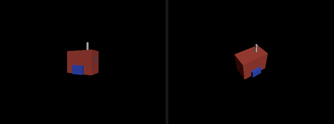 | `BoxImpostorBaker`, `BaseMaterial3D.heightmap_impostor`, Project > Tools > Bake Box Impostor | all (bake: Forward+) |
| **G5c** | **Box impostors by the visual hull**: the view ray traced through the box against all the faces' reliefs at once - inner corners and walls seen edge-on by one face right (L-shaped buildings, niches)<br>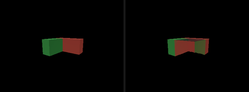 | `BaseMaterial3D.heightmap_impostor_faces`, `BoxImpostorBaker.hull` | all |
| **G6** | **Planar reflections**: a camera mirrored in a plane renders the scene (raw HDR, clipped at the plane by hardware clip distances), the plane's surfaces read it in screen space - mirrors, glass, wet decks, calm water without raytracing<br> | `PlanarReflection3D`, `BaseMaterial3D.planar_reflection_*`, `REFLECTION`, `RS.camera_set_clip_plane` / `camera_set_raw_output`, `RD::SUPPORTS_CLIP_DISTANCE` | all |
| **G7** | **Tessellation and displacement**: the mesh tessellated once to a target edge length (no T-junctions, Phong smoothing optional), the vertex shader displaces it by a height map with the relief's normal per pixel, the LODs made on the displaced shape coarsen it with the distance - true displacement without hardware tessellation shaders<br>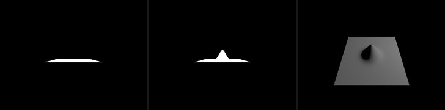 | `BaseMaterial3D.displacement_*`, `MeshTessellator`, MeshInstance3D > Mesh > Tessellate Mesh... | all |
| **G4b** | **Snow**: the world's snow lies on what faces up (with the normal map's detail), up to the steepest slope it rests on, the low places of the height map first, none under cover; wetness and snow in the Compatibility renderer too<br>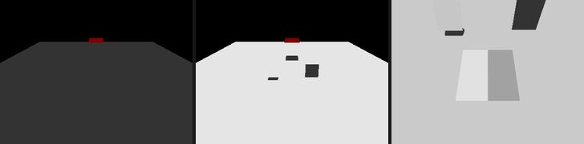 | `Environment.snow`, `SNOW`, `BaseMaterial3D.snow_*`, `RS.environment_set_snow` | all |
| **G7b** | **The fork's shader features in VisualShader**: true displacement and the relief's normal as nodes, the planar reflection's output, the world's wetness and snow as inputs<br>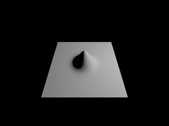 | `VisualShaderNodeDisplace`, `VisualShaderNodeHeightNormal`, output Reflection, inputs wetness / snow | all |
| **G5d** | **Curtains and blinds** in the fake interiors' windows: drawn or lowered to a random extent per window, lit from the room<br>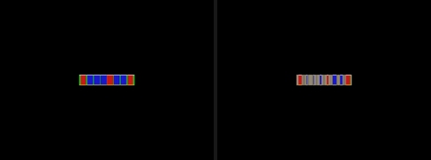 | `BaseMaterial3D.interior_curtains` / `_blinds` / `_curtain_color` | all |
| **G6b** | **PlanarReflection3D in the editor**: a gizmo with the size's handles, the reflection previewed with the editor's camera (the scene untouched); no reflection rendered while the mirror is out of view | `PlanarReflection3D.is_in_view` | all |
| **G7c** | **The displacement's mipmap** chosen for a tessellated mesh (about a texel per edge), set by Tessellate Mesh...<br>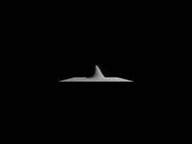 | `MeshTessellator.get_displacement_texture_lod` | all |
| **E13b** | **The frame's depth pyramid** for effects and GPU culling: every mipmap of the depth's range (farthest, nearest), built on demand<br> | `RenderSceneBuffersRD.get_hiz` | Forward+, Mobile |
| **E14c** | **A second vec4 of custom data** per MultiMesh instance (`INSTANCE_CUSTOM2`)<br> | `MultiMesh.use_custom_data2`, `RS.multimesh_instance_set_custom_data2` | Forward+, Mobile |
| **G5e** | **Octahedral impostors with depth** for far cranes, masts, ships: one quad, 3 parallax-traced frames blended, lit normals, true depth and shadows; editor bake<br>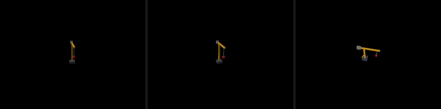 | `OctahedralImpostorBaker` | Forward+, Mobile, Compatibility |
| **E10c** | **Scrolling shadow cascades**: a cascade that moved with the camera shifts its cached depth and draws only the uncovered strips; the same image as redrawing<br>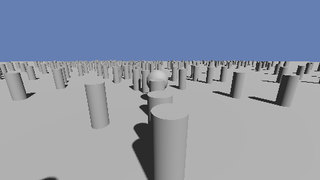 | `rendering/lights_and_shadows/directional_shadow/cache_scrolling` | Forward+ |
| **E5d** | **Ray tracing on D3D12** (DXR 1.1): the path tracer, DDGI, ReSTIR and ray-traced shadows as on Vulkan. Based on upstream PR #118654 (new Mesa); mesh buffers as an array of storage buffers instead of addresses, bindless textures with a waterfall over non-uniform indices | `RenderSceneBuffersRD.get_raytracing_geometry_buffers` | D3D12 |
| **E7b** | **Mesh and task shaders on D3D12** (mesh shader tier 1, SM 6.5): SPIR-V → HLSL (SPIRV-Cross) → DXIL (DXC, `dxcompiler.dll` next to the executable), `DispatchMesh` and `ExecuteIndirect` | as E7 | D3D12 |
| **E24c** | **FSR 3 frame generation on D3D12**: a second present of the swap chain in the D3D12 driver | `Viewport.frame_generation` | D3D12 |
| **AA1** | **Analytic alpha-cutout edge**: the fully covered middle stays opaque, the edge is blended in the transparent pass, far away the coverage comes from the mipmap (distant grass does not vanish). No MSAA, no history; best together with FSR 3.1<br> | `BaseMaterial3D.ALPHA_ANTIALIASING_FRINGE`, `render_mode alpha_fringe` | Forward+, Mobile (AA4) |
| **AA2** | **Distance-field alpha masks**: albedo / SDF / MSDF masks baked from the alpha (msdfgen); a leaf's outline stays sharp when magnified. The path tracer, DDGI and ReSTIR test the same mask<br>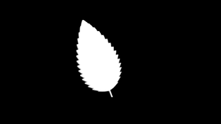 | `BaseMaterial3D.alpha_mask_mode`, `alpha_mask_texture`, `bake_alpha_mask()` | all |
| **AA3** | **Anti-aliased wires** (Persson's wires): a cylinder along local Y thinner than a pixel is drawn half a pixel wide with the missing thickness as transparency; rigging and rails do not break into dots or flicker<br>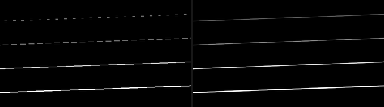 | `BaseMaterial3D.wire_antialiasing` (with `TRANSPARENCY_ALPHA`) | all |
| **AA4** | The AA1 fringe in the Mobile renderer; the switch to the mipmap's alpha on levels 0…2<br>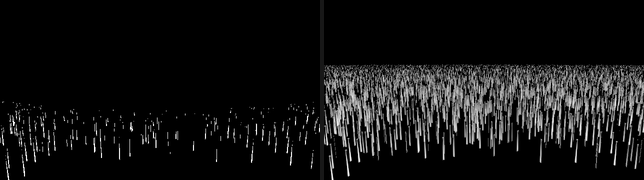 | as AA1 | Mobile |
| **GB1** | **Thin G-buffer**: on request, the Forward+ depth prepass also writes albedo and a surface class<br> | `CompositorEffect.needs_gbuffer`, `BaseMaterial3D.surface_class`, `SURFACE_CLASS` | Forward+ |
| **GB2–GB3** | **Surface decals**: footprints, ruts and craters change the height (normal), wetness, roughness and color of any surface under them; overlapping heights add up, the response depends on the surface class<br> | `render_mode surface_decal` | Forward+ |
| **G4c** | **Water film**: a material writes the share of its micro-relief under water; Forward+ then smooths the roughness as water on a rough surface (Fresnel toward the horizon). The decals' wetness uses the same model<br>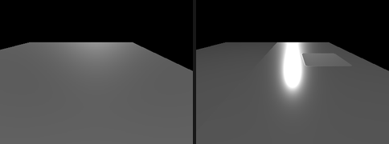 | `WET_FILM` | Forward+ |
| **L1** | **DDGI screen probes**: a probe every 16 (8) pixels of the visible surface, rays through the TLAS, hits read the lit previous frame; contact bounce light and sky occlusion on top of the DDGI grids<br>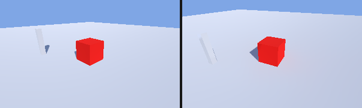 | `Environment.ddgi_screen_probes_enabled` | Vulkan, D3D12 + ray query |
| **L2** | **Reflections**: traced glossy reflections up to a roughness (a ray per 2×2 pixels, accumulation and a filter along the surface), the specular of rough surfaces from the screen probes instead of the sky<br> | `Environment.ddgi_reflections_max_roughness` | Vulkan, D3D12 + ray query |
| **V1** | **Cluster LOD — the cluster DAG** (meshoptimizer): clusters of 128 triangles, groups simplified level by level with locked borders; any error threshold cuts the mesh without holes. Saved with the mesh | `ArrayMesh.build_cluster_lod()` | — (CPU) |
| **V2** | **Cluster LOD on the GPU**: for a `MeshInstance3D` with a DAG, a compute pass picks the cut by the error on screen every frame (camera list in the frustum), drawn as a regular surface through indirect draws<br>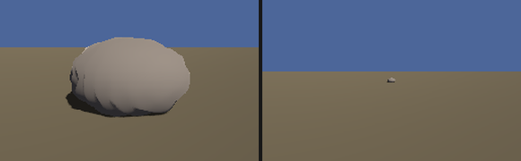 | `mesh_lod_threshold` | Forward+ |
| **V3** | **Cluster LOD in shadows**: every shadow pass has its own cut (error under a texel of its map; cascades in world units, so the E10 cache stays valid), culled by its planes, also for meshes outside the view; one shared index buffer written on the GPU<br>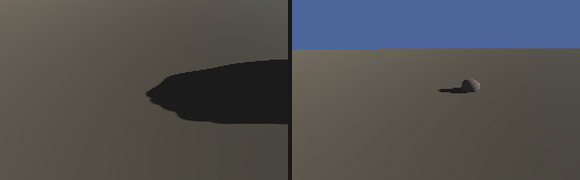 | — | Forward+ |
| **V4** | **Cluster LOD streaming**: clusters in a shared GPU pool, pages (DAG groups) loaded on the selection's requests (async feedback, a budget per frame), roots always resident, eviction by age; a coarse ancestor is drawn until a page arrives, no cracks<br>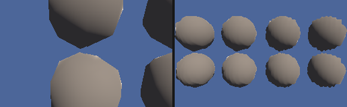 | `rendering/mesh_lod/cluster_streaming/pool_size_mb`, `RS.cluster_streaming_get_stats()` | Forward+ |
| **V5-T1** | **Software rasterizer — visibility buffer**: tiny triangles of a MultiMesh (stones) are rasterized by compute (edge functions, depth and payload atomics) into the viewport's visibility buffer; the hardware camera passes skip it<br>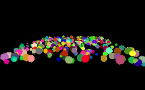 | `MultiMesh.software_raster` | Forward+ |
| **V5-T2** | **Shading from the visibility buffer**: software-rasterized instances are shaded by an ordinary Godot material — the object's screen rectangle in the prepass and opaque pass, the pixel's attributes from the buffer, then lights, shadows, GI and fog as for any surface<br>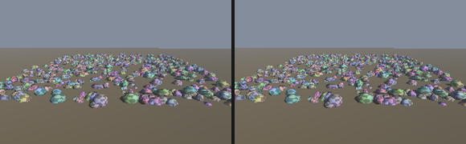 | `render_mode visibility_resolve` | Forward+ |
| **V5-T3** | **Split by size on screen**: an indirect MultiMesh with `software_raster` and GPU view culling (E25) gives the software rasterizer only instances up to 32 pixels (after frustum and Hi-Z), the rest are drawn as meshes with LOD<br>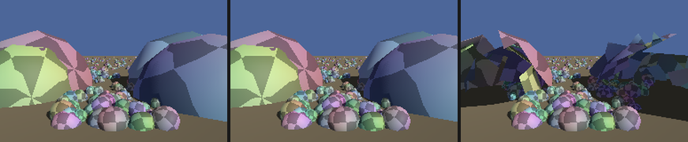 | `RS.multimesh_set_indirect_view_culling` | Forward+ |
| **V5a** | **Software rasterizer in shadows**: in sun cascades and the per-object map, instances up to 32 texels are rasterized by compute and their depth merged into the shadow map; the rest as meshes<br>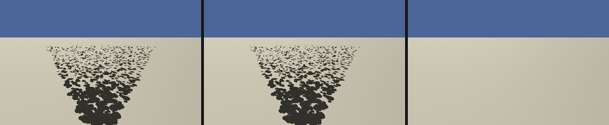 | `RS.multimesh_set_indirect_shadow_culling` + `software_raster` | Forward+ (spot, omni: meshes) |
| **M1–M3** | **Materials** after "Material Advances in Call of Duty: WWII" (Chan 2018): multiple-scattering diffuse, micro-shadowing of direct light by the material's AO, multi-bounce AO for every occlusion | `rendering/shading/overrides/multiscatter_diffuse`, `micro_shadowing`, `multi_bounce_ao` (on by default) | Forward+, Mobile |
| **M6** | **Sheen** (cloth): Charlie lobe (Estevez and Kulla 2017) with energy taken from the base layer<br> | `BaseMaterial3D.sheen_*`; fragment built-ins `SHEEN`, `SHEEN_ROUGHNESS` | Forward+, Mobile |
| **F5** | **Thin-film iridescence** (Belcour and Barla 2017): oil on water, heat tint | `BaseMaterial3D.iridescence_*`; `IRIDESCENCE`, `IRIDESCENCE_IOR`, `IRIDESCENCE_THICKNESS` | Forward+, Mobile |
| **F6** | **Physical refraction**: index of refraction, slab thickness, Beer-Lambert absorption, Fresnel of the interface | `BaseMaterial3D.refraction_physical`, `refraction_ior`, `refraction_thickness`, `refraction_absorption_color/_distance` | Forward+, Mobile |
| **M4, M8** | Reoriented normal mapping for the detail normal; measured F0 of 13 metals | `BaseMaterial3D.detail_normal_rnm`, `BaseMaterial3D.get_metal_albedo(Metal)` | all |
| **M5** | Height and cavity occlusion from a normal map, for materials without an AO map | `Image.normal_map_to_height()`, `Image.normal_map_to_cavity()` | — (CPU) |
| **F4** | The roughness limiter (specular anti-aliasing) measures normal variance in output pixels under a temporal upscaler | `rendering/anti_aliasing/screen_space_roughness_limiter/*` | Forward+, Mobile |
| **fixes** | E6 async-compute barrier stage masks (`0013`); Compatibility 3D shaders failed to compile (`0035`); a material whose `Texture2DRD` lost its RD texture stopped drawing (`0040`); Mobile depth and unshaded passes failed to compile with `micro_shadowing` on (`0048`); FFX 3 backend names copied with `wcsncpy` without a terminator, sheen and iridescence outputs in VisualShader and the text shader editor (`0049`); a deadlock at startup between shader variant and pipeline compilation, stock (`0050`); directional soft shadows (PCSS): a halo around thin objects, no contact hardening, twice the light's size, self-shadowing of tilted receivers in the kernel; an uninitialized `EditorDock` layout, all stock (`0053`); the tests build on Windows (`near` / `far` macros, `0074`); the D3D12 build stops on a Mesa NIR without ray tracing, the executable relinks when the NIR libraries change (`0077`, `0079`); FSR 3 frame generation on D3D12 removed the device after a few seconds (`0081`); shader cache version 5 after E5d (`0082`); the editor singleton is not asked for in command-line runs, stock (`0099`); D3D12: debug layer messages in the log with `--gpu-validation` (`0102`), a barrier whose stages do not match its access keeps the access instead of becoming COMMON (`0104`); software rasterizer: shadow merge and clears on D3D12 (`0101`, `0103`, `0105`), particles are not asked whether they are software-rasterized (`0106`), a rectangle buffer per viewport (`0107`); `surface_tool.cpp` builds without SCU (`0107`) | — | — |
| **core** | Fork identity: the `mariner` feature tag in every build, default build name `mariner` | `OS.has_feature("mariner")` | all |
| **tests** | doctest coverage of all of the above, `tests/mariner/test_mariner_*.cpp`, tag `[Mariner]` | `scons tests=yes` | — |

The pictures (`docs/shots/`, one per patch, several panels each) are frames of the end-to-end scenes, rendered on an
RTX 2070 Max-Q with Vulkan by `engine/tests/run_e2e.ps1 -Shots` of the game repository and put together by
`engine/tests/shots/compose.py` (run of 18.11.2026, `0106`: 69 of 71 scenes ok, the other two fixed in `0107`).

A detailed description of each item (design, limitations, GDScript examples, manual test checklists) is in
`engine/README.md` of the game repository (in Russian), the record of the PC runs in `engine/docs/pc_checks.md`.
End-to-end scenes for lavapipe or a real GPU are in `engine/tests/<group>/` there (`run_e2e.ps1` runs them all,
on Vulkan or D3D12).

### API in short

**DLSS and frame generation (E2, E3)**

```gdscript
var sl = Engine.get_singleton("Streamline") if Engine.has_singleton("Streamline") else null
if sl and sl.get_capability(0):                   # STREAMLINE_CAPABILITY_DLSS
	get_viewport().scaling_3d_mode = Viewport.SCALING_3D_MODE_DLSS
	get_viewport().scaling_3d_scale = 0.66        # 1.0 DLAA, 0.66 Quality, 0.58 Balanced, 0.5 Perf, 0.33 Ultra Perf
	if sl.get_capability(1):                      # STREAMLINE_CAPABILITY_DLSS_G
		get_viewport().set("frame_generation", true)
		sl.set_parameter(4, 3)                    # STREAMLINE_PARAM_DLSS_G_FRAMES: 4x (2x on RTX 40)
```

If DLSS is selected but unavailable, the engine logs a warning and falls back to bilinear scaling. Frame generation
only works together with DLSS/DLAA and only in SDR: DLSS-G doesn't support an FP16 HDR swap chain.

**Ray tracing in a CompositorEffect (E5a)**

In `_render_callback`, `RenderSceneBuffersRD` provides `has_raytracing_scene()`, `get_raytracing_tlas()`,
`get_raytracing_instance_buffer()` (128 bytes per instance), `get_raytracing_material_buffer()` (96 bytes per
instance), `get_raytracing_instance_count()`, `get_raytracing_texture_uniform_set(shader, set)` and
`get_raytracing_textures()`. Ray mask: bits 0–6 are layers 1–7, bit 7 is layers 8–20. Transparent surfaces are not
added to the TLAS. ShaderMaterial code is not run on hits: material parameters are read by name (`albedo`,
`roughness`, `metallic`, `emission`, `texture_albedo`).

**Async compute (E6)**

```gdscript
var rd := RenderingServer.get_rendering_device()
var async: bool = rd.call("async_compute_begin")   # true: the work goes to the second queue
var cl := rd.compute_list_begin()
# ... resources created with *_ASYNC_COMPUTE_BIT
rd.compute_list_end()
rd.call("async_compute_end")
```

Rule: whatever the main queue reads in frame N must have been written by the second queue in frame N−1, so use
double buffering. `async_compute_get_info()` shows what went to the second queue and why anything fell back to the
main one.

**Second GPU (E8)**

```gdscript
# on a worker thread, not the main thread
for d in RenderingServer.call("get_physical_devices"):
	print(d.index, " ", d.name, " ", d.type_name, " uma=", d.uma, " main=", d.is_main)
var rd: RenderingDevice = RenderingServer.call("create_local_rendering_device_on", 1)
# ... compute_list_* ; rd.submit(); rd.sync(); rd.buffer_get_data(buf); rd.free()
```

Data moves to the main GPU through system RAM, so keep results small: fields and spectra, not frames. Ray query and
mesh shaders are enabled on a local device only if that device supports them. Local devices don't get the E6 second
queue.

**Lighting and image (E12, E18, F1, F3)**

```gdscript
var env: Environment = $WorldEnvironment.environment
env.set("ddgi_enabled", true)             # Vulkan / D3D12 + ray query; otherwise ignored
env.ssao_enabled = true
env.set("ssao_gtao", true)                # E18
env.set("ssao_gtao_thickness", 0.5)       # F1, meters; 0 = horizon-based GTAO
env.set("color_grading_enabled", true)    # F3, Forward+
env.set("color_grading_temperature", 5600.0)
env.set("color_grading_shadows", Color(0.9, 0.95, 1.1))
```

**GPU-driven static geometry (E25)**

```gdscript
for mi in get_tree().get_nodes_in_group("static_props"):
	mi.set("gpu_static", true)            # eligible MeshInstance3D only; others stay on the regular path
print(RenderingServer.call("scenario_get_gpu_static_info", get_world_3d().scenario))
```

**Virtual geometry (V1–V5)**

```gdscript
# Cluster LOD: once per mesh (saved with it); a MeshInstance3D with it draws a cut chosen on the GPU.
rock_mesh.call("build_cluster_lod")
# Stones: an indirect MultiMesh, tiny instances rasterized by compute, shaded by a visibility_resolve material
# (shader: render_mode visibility_resolve; everything in fragment()).
RenderingServer.multimesh_allocate_data(mm, count, RenderingServer.MULTIMESH_TRANSFORM_3D, true, false, true)
RenderingServer.call("multimesh_set_indirect_view_culling", mm, true)    # split by size on screen (V5-T3)
RenderingServer.call("multimesh_set_indirect_shadow_culling", mm, true)  # also in sun shadows (V5a)
RenderingServer.call("multimesh_set_software_raster", mm, true)
```

---

## Building

No special flags are needed: any build of this repository includes all the extensions and identifies itself as the
fork.

### Windows (MSVC)

Requirements: Git, Python 3 with `pip install scons`, Visual Studio 2022 Build Tools (C++).

```bat
scons platform=windows target=editor production=yes d3d12=yes vulkan=yes
scons platform=windows target=template_release production=yes d3d12=yes vulkan=yes
```

In the game repository, `engine/build_windows.bat` does all of this:
- checks the tools;
- installs the D3D12 dependencies (Mesa NIR, Agility SDK);
- downloads Streamline (`fetch_streamline.py`, verified by SHA-256);
- enables Aftermath if the SDK is placed in `engine/deps/` (`fetch_aftermath.py`);
- builds the editor and the templates.

`build_windows.bat editor` builds only the editor. `build_windows.bat tests` builds with tests and runs them.

| SCons option | default | what |
|---|---|---|
| `use_streamline` | `yes` | DLSS, DLSS-G, Reflex, PCL; turns itself off outside Windows |
| `use_aftermath` | `no` | Nsight Aftermath. Needs the SDK headers in `thirdparty/aftermath/include`; without them the build continues without Aftermath and prints a warning |

### Linux → Windows (MinGW)

```sh
scons platform=windows use_mingw=yes target=editor d3d12=yes vulkan=yes production=yes lto=none
```

Mesa NIR for gcc is expected in `bin/build_deps/mesa-x86_64-gcc`. This build is slower, has no Agility SDK, and is
meant for checking changes.

### DLLs next to the executable

Without these DLLs the engine works like stock Godot, and the DLSS capabilities report `false`.

* **Streamline 2.10.0** (production DLLs from `bin/x64/` of the
  [SDK release](https://github.com/NVIDIA-RTX/Streamline/releases/tag/v2.10.0)):
  `sl.interposer.dll`, `sl.common.dll`, `sl.dlss.dll`, `nvngx_dlss.dll`. E3 also needs `sl.dlss_g.dll`,
  `nvngx_dlssg.dll`, `sl.reflex.dll`, `sl.pcl.dll` and `NvLowLatencyVk.dll`. Godot export doesn't copy them: when
  exporting a game, put them next to the executable by hand, together with `streamline.license.txt`,
  `nvngx_dlss.license.txt` and `reflex.license.txt`.
* **Aftermath**: `GFSDK_Aftermath_Lib.x64.dll`. Only needed for `--debug-shaders`.

## Tests

```sh
scons platform=<...> target=editor tests=yes
godot --test --headless --test-case="*Mariner*"
```

The tests cover:
- the shading language and compiler (E1, E4, E7, E16);
- enums, properties and their defaults, project settings, ClassDB bindings;
- the "Streamline unavailable" path;
- the fork identity;
- where Vulkan is available (including software lavapipe): device and resource creation for E6–E8 and the physical
  device list;
- data layouts and CPU-side math of the rendering features (E10–E25, F1, F3, M1–M3), e.g. the white balance matrix.

The image itself is checked by end-to-end scenes in the game repository (`engine/tests/`), not by doctest.

Regular builds are not affected by the tests.

In the game repository, `engine/test_patches.sh [--repo <clone>] [--binary <godot built with tests=yes>]` checks the
patch series in `engine/patches/`:
- the patches apply cleanly to `4.7.2-stable`;
- the result matches this fork's tree;
- `git diff --check`, clang-format on the changed lines, and the tests pass.

## Third-party code

| | source | license |
|---|---|---|
| `thirdparty/streamline/` | NVIDIA Streamline SDK 2.10.0 (headers) | MIT; DLSS / DLSS-G / Reflex: NVIDIA redistribution licenses |
| `drivers/streamline/` | ported from NVIDIA-RTX/godot, plus our changes (HUD-less, MFG, PCL) | MIT |
| `drivers/aftermath/` | ported from NVIDIA-RTX/godot; the Aftermath SDK is not part of the repository | MIT (code), NVIDIA license (SDK) |
| `servers/rendering/renderer_rd/shaders/raytracing/`, `render_raytracing*`, `render_pathtracer*` | ported from NVIDIA-RTX/godot, reworked for inline ray query | MIT |
| `shaders/effects/gtao.glsl` (E18), `shaders/effects/tonemap_gt7_inc.glsl` (E23) | ported from [Spartan Engine](https://github.com/PanosK92/SpartanEngine), MIT snapshot `cb258a150` only (later commits are under a non-MIT license) | MIT |
| `shaders/effects/cas.glsl` (E23) | AMD FidelityFX CAS, as used by Spartan Engine | MIT |
| `thirdparty/amd-fsr3/` (E24) | AMD FidelityFX SDK 1.1.4: FSR 3.1 and frame generation, with 2 small patches | MIT |
| D3D12 ray tracing (E5d) | based on upstream Godot PR #118654 | MIT |
| mesh shaders on D3D12 (E7b) | SPIRV-Cross (Godot's `thirdparty/spirv-cross`); DXC (`dxcompiler.dll`, `dxil.dll`) is downloaded by `install_d3d12_sdk_windows.py`, not part of the repository | Apache 2.0; DXC: LLVM / NCSA |
| cluster DAG (V1), distance-field masks (AA2) | meshoptimizer and msdfgen, already in Godot's `thirdparty/` | MIT |

Everything else (E9–E25, F, G, M, AA, GB, L, V) is our own code, written after published papers (the software
rasterizer after Laine and Karras 2011 and Nanite 2021). Ideas from other engines
(CryEngine, X-Ray, Filament, Spartan after `cb258a150`) are used without copying code. `COPYRIGHT.txt` lists every
third-party file.

## Known limitations

* DLSS Ray Reconstruction is not ported.
* Mesh shaders on D3D12 need `dxcompiler.dll` and `dxil.dll` next to the executable (the build puts them in `bin`).
* DLSS-G needs an RTX 40/50, a recent driver and hardware-accelerated GPU scheduling (HAGS). It doesn't work with
  HDR (FP16 swap chain). Viewports presented to the screen on their own on top of the main one are treated by
  DLSS-G as UI.
* On D3D12 with Streamline the device is created through `sl.interposer.dll`, and the Agility SDK is not used then.
* Multi-threaded rendering (`thread_model = Multi-Threaded`) with Streamline is untested.
* GPU static batches (E25) are not culled on the GPU for dual-paraboloid point light shadows and XR; they are drawn
  whole there. Fading visibility ranges and `visibility_parent` keep an instance on the regular path.
* FSR 3 frame generation needs V-Sync.
* The new fragment built-ins `SHEEN*` and `IRIDESCENCE*` are accepted by Compatibility but have no effect there.
* Cluster LOD (V2–V4) is for single `MeshInstance3D`s (not MultiMesh, not skinned); MultiMesh keeps discrete LODs.
  Streaming keeps a CPU copy of the indices.
* The software rasterizer (V5) uses the first surface of the mesh, at most 127 such MultiMeshes per frame; in its
  material `vertex()` does not run. Spot and omni shadows draw such instances as meshes. It is not faster than meshes
  yet: instances have no LOD in it.
* Color grading (F3), lens effects, motion blur, contact shadows, DDGI, ReSTIR and GPU static batches are Forward+
  only.
* GPU-dependent parts are tested by building, doctest, end-to-end scenes on lavapipe, and in the game on a PC with an
  NVIDIA RTX GPU. AMD and Intel, including integrated GPUs as the second GPU (E8), have barely been tested.

## Branches and updating

* `master` is the working branch: the 4.7.2-stable tree with all Mariner changes. The game uses the fork as a
  submodule (`engine/godot` in [mariner-simulator](https://github.com/shibisty/mariner-simulator)) pinned to a
  specific commit.
* The same changes, one patch per task, are kept in `engine/patches/` of the game repository (`git am` on top of
  `4.7.2-stable`). `engine/test_patches.sh` checks that the series produces exactly this fork's tree, except
  `README.md` and `README.godot.md`. The fork has no upstream tags; fetch the base once with
  `git fetch --no-tags https://github.com/godotengine/godot.git tag 4.7.2-stable`.
* Moving to a new Godot version: apply the patch series to the new tag, resolve conflicts, bring the result into
  `master`, then run `--test-case="*Mariner*"` and `test_patches.sh`.
